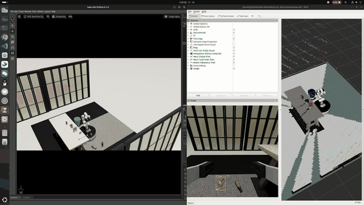
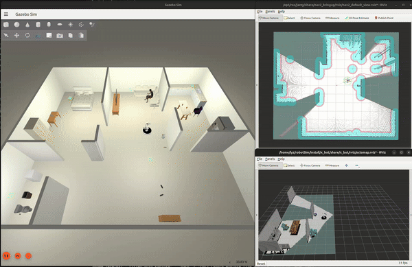
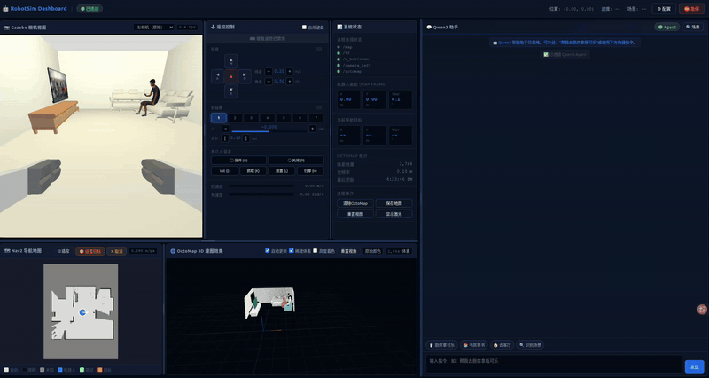

# Embodied-RobotSim

[English](README_en.md)

基于 **ROS 2 Jazzy + Isaac Sim 6.1 / Gazebo Harmonic** 的移动抓取仿真项目。支持 FAST-LIO 建图定位、Nav2 自动探索与导航、YOLOE 感知、CUDA 语义体素建图、GraspNet 抓取和自然语言任务闭环。

## 演示

### Isaac Sim 抓取仿真



### Gazebo 建图导航仿真



### 具身任务闭环



## 启动方式

在项目根目录执行。无参数默认 **Isaac Sim**；添加 `--sim gazebo` 切换后端，也可修改脚本顶部的 `SIM_BACKEND`。

| 命令 | 功能 | 默认场景 | 额外前提 |
|---|---|---|---|
| `./start_mapping_and_explore.sh` | 自动探索、FAST-LIO 建图、语义建图；探索结束保存地图 | `simple_room` | 无需已有地图 |
| `./start_mapping_and_explore.sh --mode navigation` | ICP 定位、Nav2 导航，在 RViz 设置 Nav2 Goal | `simple_room` | 同场景完整地图包 |
| `./start_pick_and_place.sh` | 原地扫描，抓取并放置 book / cup / coke / bottle / shoe | `manipulation_test` | 无需已有地图 |
| `./start_pick_and_place.sh --mode navigation` | 导航后执行感知抓取任务 | `simple_room` | 完整地图包，检查任务目标坐标 |
| `./start_embodied.sh` | 定位、导航、感知、抓取、Agent 和 Web UI | `simple_room` | 完整地图包、Agent 依赖、本地模型或云端 API Key |
| `./stop_robot_sim.sh` | 停止两种后端的项目服务，关闭服务窗口并清理日志 | — | — |

```bash
# Gazebo 自动探索建图
./start_mapping_and_explore.sh --sim gazebo

# 指定保存后的地图导航
./start_mapping_and_explore.sh --sim gazebo --mode navigation --bundle maps/gazebo/simple_room

# Isaac Sim 抓取
./start_pick_and_place.sh

# 具身闭环，启动后打开 http://localhost:8888
export DASHSCOPE_API_KEY='你的 API Key'
./start_embodied.sh --llm cloud --bundle maps/gazebo_simple_room
```

每次启动会先停止上次项目会话。统一只打开一个 RViz，显示点云、轨迹、语义体素、地图与规划路径。建图和抓取入口默认构建；具身入口默认使用已有构建，需要时添加 `--build`。

常用选项：`--sim isaac|gazebo`、`--odometry lio|vio`、`--world 场景`、`--bundle 地图目录`、`--headless`、`--build` / `--no-build`。默认值在各入口脚本顶部。

## 依赖与首次配置

### 1. 公共环境

使用 **Ubuntu 24.04、ROS 2 Jazzy、NVIDIA GPU、CUDA Toolkit 和 TensorRT 开发环境**。本项目使用 TensorRT 10；CUDA 需提供 `nvcc`，TensorRT 需提供头文件、库及 `trtexec`。用系统 Python 3.12 构建 ROS，先退出 Conda。

```bash
sudo apt update
sudo apt install build-essential cmake git curl python3-vcstool python3-rosdep python3-colcon-common-extensions \
  python3-numpy python3-yaml python3-dev python3-venv libeigen3-dev libpcl-dev \
  libglut-dev libgl-dev libglu1-mesa-dev libssl-dev \
  ros-jazzy-navigation2 ros-jazzy-nav2-bringup ros-jazzy-nav2-graceful-controller \
  ros-jazzy-moveit ros-jazzy-moveit-ros-perception \
  ros-jazzy-ros2-control ros-jazzy-ros2-controllers \
  ros-jazzy-cv-bridge ros-jazzy-sensor-msgs-py

# 具身 Web 服务（start_embodied.sh 需要，安装到系统）
sudo apt install ros-jazzy-rosbridge-server ros-jazzy-web-video-server

# rosdep 未初始化时先执行一次：sudo rosdep init
bash scripts/setup/setup_dependencies.sh
bash -c 'source /opt/ros/jazzy/setup.bash && rosdep update && rosdep install --from-paths src --ignore-src -r -y'
```

安装脚本下载固定版本的 `src/localization/FAST_LIO_ROS2` 并初始化 ikd-Tree 子模块。项目自带 Livox 消息包，不需要真实 Livox SDK。

具身 Agent 的 Python 依赖可手动安装到系统目录下的独立环境，避免依赖工作区 `.venv/agent`：

```bash
sudo python3 -m venv --system-site-packages /opt/embodied-agent
sudo /opt/embodied-agent/bin/python -m pip install openai fastapi uvicorn websockets
```

在 `~/.zshrc`（Bash 使用 `~/.bashrc`）加入以下配置，并在当前终端执行一次：

```bash
export AGENT_PYTHON=/opt/embodied-agent/bin/python
```

安装后检查（新终端中执行，避免加载工作区缓存环境）：

```bash
bash -c 'source /opt/ros/jazzy/setup.bash && ros2 pkg prefix rosbridge_server && ros2 pkg prefix web_video_server'
/opt/embodied-agent/bin/python -c 'import openai, fastapi, uvicorn, websockets; print("Agent dependencies OK")'
```

两个 ROS 包应位于 `/opt/ros/jazzy`。以上安装完成后，具身 Web/Agent 可替代
`.cache/embodied_sysroot` 和 `.venv/agent`；`.cache` 还可能包含 VIO 运行库及场景资产，
不能因此整目录删除。可选 VIO 依赖与版本要求见 [定位模块说明](src/localization/README.md)。

### 2. 选择仿真后端

**Isaac Sim：**安装 Isaac Sim 6.1，目录必须包含 `python.sh`。在 `~/.zshrc`（Bash 使用 `~/.bashrc`）配置实际路径：

```bash
export ISAAC_SIM_PATH="$HOME/isaacsim"
export ISAAC_ASSETS_PATH="$HOME/isaacsim_assets/6.1"
export CUDA_HOME=/usr/local/cuda
export PATH="$CUDA_HOME/bin:/usr/src/tensorrt/bin:$PATH"
export LD_LIBRARY_PATH="$CUDA_HOME/lib64${LD_LIBRARY_PATH:+:$LD_LIBRARY_PATH}"
```

TensorRT 使用 tar 包安装时，还需加入其 `bin` 和 `lib` 路径。重新打开终端，确认 `nvcc --version`、`trtexec --version` 和 `test -x "$ISAAC_SIM_PATH/python.sh"` 成功。

**Gazebo：**额外安装 Harmonic 桥接、控制及射线查询依赖；只使用 Isaac 时不需要这些包。

```bash
sudo apt install ros-jazzy-ros-gz ros-jazzy-gz-ros2-control \
  ros-jazzy-gz-sim-vendor ros-jazzy-gz-common-vendor ros-jazzy-gz-plugin-vendor libembree4-4 libembree-dev
```

`libembree4-4` 是 Gazebo 后端的运行依赖，`libembree-dev` 用于编译。
若旧插件曾链接 `.cache/embree`，删除该目录前须先安装系统依赖。
出现 `No plugins detected in library` 时可运行以下检查，确认动态库依赖及插件注册：

```bash
source /opt/ros/jazzy/setup.bash
source install/setup.bash
bash scripts/runtime/check_gazebo_plugins.sh
```

两种后端共用 `simple_room`、`manipulation_test`，以及定位、导航、感知、建图和抓取链路。Office、NVIDIA Simple Room 等 USD 场景仅支持 Isaac。

场景工具从固定历史提交 `92b0409ccf83549e74d03966bdde7f0f700ff927` 提取原始资产，克隆时须保留包含该提交的 Git 历史。默认资产首次启动自动准备，也可提前执行：

```bash
# Isaac：转换共同场景为 USD
"$ISAAC_SIM_PATH/python.sh" scripts/assets/migrate_gazebo_scenes.py --worlds simple_room manipulation_test
# Gazebo：准备 SDF 与模型，不依赖 Isaac
python3 scripts/assets/prepare_gazebo_scene.py --world simple_room
# 可选：下载 Isaac Office / NVIDIA Simple Room
"$ISAAC_SIM_PATH/python.sh" scripts/assets/download_isaac_environments.py
```

### 3. 模型与构建

从 [模型目录](https://drive.google.com/drive/folders/1gPPyvKqiYd7cg2vUyqucV1CjLTf6J0y2?usp=drive_link) 下载以下文件，并保留源码中的 `yoloe_infer/models/tokenizer_data.json.gz`：

| 模型 | 放置目录 |
|---|---|
| `yoloe-v8l-text-prompt-multi_nc10_fp16.onnx` | `src/perception/yoloe_infer/models/` |
| `graspnet.onnx` | `src/perception/graspnet_infer/` |

```bash
bash src/perception/graspnet_infer/tensorrt_plugins/build.sh
trtexec --onnx=src/perception/yoloe_infer/models/yoloe-v8l-text-prompt-multi_nc10_fp16.onnx \
  --saveEngine=src/perception/yoloe_infer/models/yoloe-v8l-text-prompt-multi_nc10_fp16.engine
trtexec --onnx=src/perception/graspnet_infer/graspnet.onnx \
  --saveEngine=src/perception/graspnet_infer/graspnet.trt \
  --staticPlugins=src/perception/graspnet_infer/tensorrt_plugins/build/libfps_plugin.so
bash -c 'source /opt/ros/jazzy/setup.bash && colcon build --symlink-install --cmake-args -DCMAKE_BUILD_TYPE=Release'
```

换 GPU 或 TensorRT 版本后重新生成 engine。交互式 Zsh 加载 `setup.zsh`，Bash 加载 `setup.bash`；启动脚本内部自动加载 Bash 环境。

### 4. 具身闭环依赖

先按“公共环境”安装 Web ROS 包及 Agent Python 依赖。本地 Qwen 的安装与启动见
[Agent 说明](src/embodied/llm_agent/README.md)，具身入口默认使用本地模型。使用 DashScope 时：

```bash
export AGENT_PYTHON=/opt/embodied-agent/bin/python
export DASHSCOPE_API_KEY='你的 API Key'
./start_embodied.sh --llm cloud --bundle maps/gazebo_simple_room
```

Web UI：**http://localhost:8888**。云端模式需要 API Key，本地模式无需云端密钥。
如需无需 sudo 的工作区安装，可改用 `bash scripts/setup/setup_embodied_dependencies.sh --local`，
依赖将放入 `.cache/embodied_sysroot` 和 `.venv/agent`；使用该环境时不要设置上述 `AGENT_PYTHON`。

## 地图与配置

导航和具身任务需要同场景地图包：`bundle.json`、`map.pcd`、`map.yaml`、`map.pgm`。探索结束自动保存，也可在已加载 ROS 环境的终端手动保存：

```bash
source /opt/ros/jazzy/setup.zsh
source install/setup.zsh
ros2 service call /localization/save_map std_srvs/srv/Trigger '{}'
```

Isaac 默认保存到 `maps/gazebo_simple_room`（沿用历史名称），Gazebo 保存到 `maps/gazebo/simple_room`。再次建图会保留已有地图并使用新目录，以启动输出为准；导航时用 `--bundle` 指定该路径。换场景或后端须使用对应地图，定位初值可通过 RViz **2D Pose Estimate** 修正。

| 配置位置 | 用途 |
|---|---|
| 根目录三个 `start_*.sh` 顶部 | 后端、场景、地图、出生位姿、自动探索、深度来源 |
| `src/planning/x_bot_navigation/config/nav2.yaml` | 导航速度、路径跟随、碰撞尺寸和障碍膨胀 |
| `src/control/x_bot_control/config/` | 底盘、控制器及后端物理差异 |
| `src/localization/x_bot_localization/config/fastlio_mid360.yaml` | 实际加载的 FAST-LIO 参数 |
| `src/robot/x_bot_sensors/config/mid360.yaml` | 公共雷达配置，默认 20 Hz 仿真时间组帧 |
| `src/mapping/semantic_voxel_mapping/config/` | 建图输入、分辨率、hit/miss 与语义融合 |
| `src/perception/yoloe_infer/configs/` | 检测类别、颜色与阈值 |
| `src/manipulation/x_bot_manipulation/config/` | 抓取放置任务及物理验收 |

建图入口默认使用 FAST-LIO 点云。具身入口 `start_embodied.sh` 的 OctoMap 几何默认随里程计选择：LIO 使用 `/fastlio/cloud_odom` 激光点云，相机提供语义标签；VIO 使用深度点云。可用 `--semantic-cloud-source depth` 显式改为相机深度。独立抓取入口默认使用所选仿真器的深度，栅格分辨率为 2 cm。切换推理深度使用 `--semantic-cloud-source depth --depth-source lsm`，需自行提供并构建本地可选模块 `src/perception/LSM_depth_infer`。抓取期间 YOLOE 图像持续输出。

源码按 `robot`、`localization`、`perception`、`planning`、`control`、`mapping`、`manipulation`、`simulation`、`embodied` 分组；运行工具在 `scripts/runtime/`，安装和资产工具在 `scripts/setup/`、`scripts/assets/`。算法和许可证见各模块。

### 手眼标定与传感器深度抓取实验

使用 AprilGrid + OpenCV Daniilidis 手眼标定；抓取使用 Isaac 内置深度传感器模型，按物理抬升与保持夹持评分。

```bash
./start_handeye_demo.sh all --output .cache/handeye/run-01 --headless
```

配置、分步执行和误差统计说明见 [手眼标定例程](src/manipulation/handeye_demo/README.md)。
